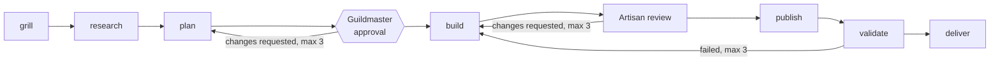
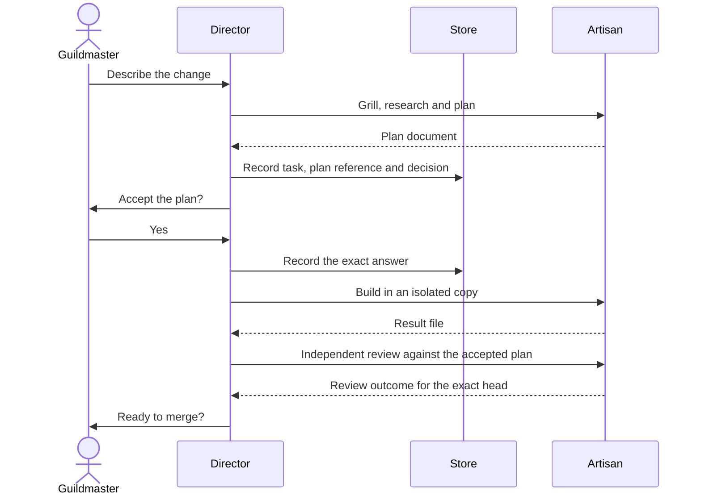
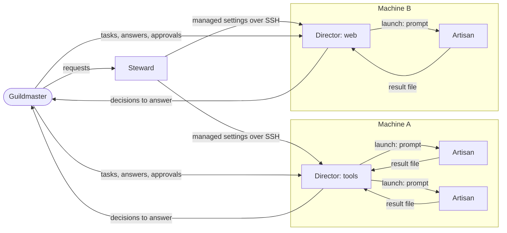
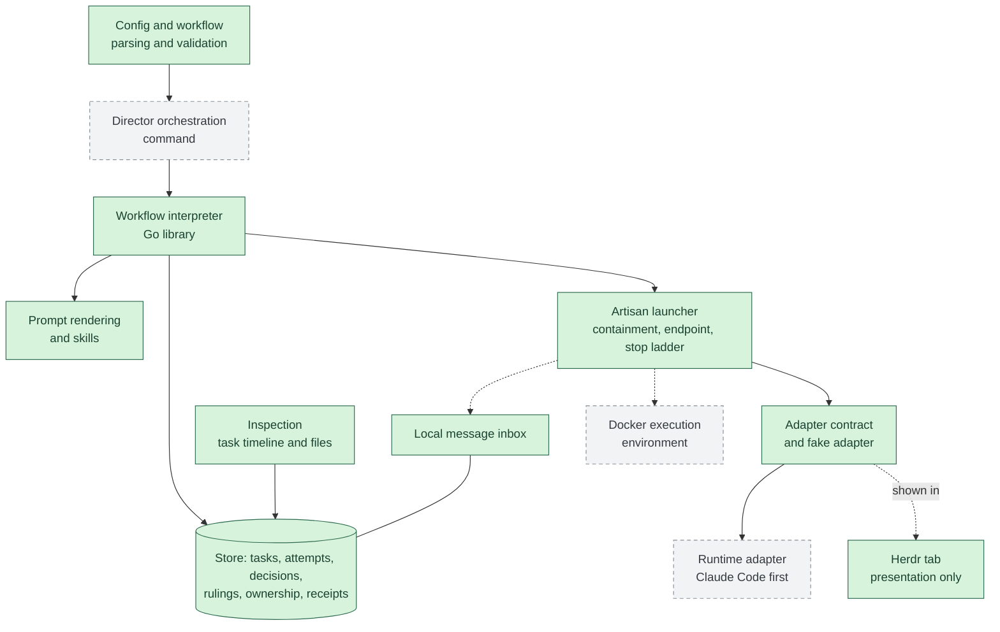

# guildhall

[](https://github.com/ndrwl/guildhall/actions/workflows/ci.yml?query=branch%3Amain)
[](go.mod)
[](LICENSE)

Guildhall lets you, the **Guildmaster**, run coding agents on the machines you own without babysitting them.
You give a Director a task; it plans the work, launches Artisan agents to do it in isolated copies of your repository, and comes back to you only when it needs a decision or your approval.
Everything it knows lives in one durable store per Director, so closing a terminal, restarting or switching agent runtime never loses work.

> **Status: foundation stage.**
> Guildhall builds and runs, but no platform or agent runtime is supported for real work yet.
> Today you can create tasks, advance them by hand with the test-only fake adapter, answer decisions and preview Steward rollouts.
> A runnable Director is planned, not built; this page marks every planned step and links its design.
> The full specification is [docs/requirements.md](docs/requirements.md).

## What Guildhall does for you

- **You talk to Directors, not to individual agents.** A Director coordinates one or more of your repositories on one machine, tracks its tasks and launches Artisans, but never does the work itself.
- **You decide; agents wait.** Plan approvals, questions and merges become durable decisions that cost no model tokens while they wait for your answer.
- **Your rules hold.** Each repository's merge policy applies whatever a workflow says, and a workflow cannot contain commands or code.
- **Work survives.** A task's state is in the store, not in an agent transcript or a terminal tab.
- **Optional central upkeep.** A Steward can roll your shared settings out to every enrolled machine, but a single Director never needs one.

## Install

Guildhall needs Go 1.27 or later.

```sh
go build -o guildhall ./cmd/guildhall
./guildhall version
./guildhall doctor
```

`doctor` reports your platform and whether `git`, `ssh`, `claude` and `herdr` are on your machine; a missing tool is reported, not treated as an error.
For example:

```console
$ ./guildhall version
guildhall v0.0.0-20261020184157-8090cc664d0a linux/amd64 go1.27.2
$ ./guildhall doctor
os: linux
arch: amd64
guildhall: v0.0.0-20261020184157-8090cc664d0a
go: go1.27.2
...
```

The release workflow publishes binaries for Linux, Windows and macOS, with a `SHA256SUMS` file, only for pushed version tags; no release has been published yet.
Installing, pinning and rolling back releases side by side is planned; see [release upgrades](docs/releases.md).

## Using Guildhall

Each step below says what works today and what is planned.
Today's commands take the Director's store file with `--store`; no command creates a store yet, so to try them, copy the test store `internal/store/testdata/schema-v1.store` to `demo.store` (it holds task `t-1` in repository `app`) and never use the committed file.
The `task new` and `task start` lines also need a Director config, `director.toml`, that declares a `[[repository]]` with `id = "app"` whose `path` is a git checkout; the examples in [configuration and workflows](docs/configuration.md) name other repositories, so change one to `app` before using it.

### 1. Set up a Director

A Director's copy holds a `config.toml` naming its repositories, their merge policy and workflow, and its Artisan profiles; see [configuration and workflows](docs/configuration.md).
A Director runs standalone on that config, or managed by a Steward that adds shared settings; see [standalone and managed Directors](docs/director-modes.md) (designed, not built).

### 2. Start a Director (planned)

Every role will start, stop, report and resume with one grammar, for example `guildhall director start claude`; see [the role grammar](docs/decisions/0053-cli-role-grammar.md).
`director start` is not built yet.
Start a role through Guildhall rather than running the agent directly, so it gets its rendered skills, settings, preflight and recorded identity.

### 3. Give it work

A task is one unit of work in one repository; creating it records it and binds the exact workflow and configuration it was accepted under.

```sh
./guildhall task new --store demo.store --config director.toml --repo app --title "Add a health check" t-2
./guildhall task start --store demo.store --config director.toml --state state --repo app t-2
```

`task start` launches the task's next ready stage as an owned Artisan attempt.
Today a Director does not yet wait in the background, so you run `guildhall step done` once an attempt's result file exists; see [tasks](docs/tasks.md) and [running a task](docs/running.md).

Each task follows a workflow.
The shipped [default workflow](internal/workflow/default.json) is:



A repository can have you review instead of an Artisan without changing any other repository; see [configuration and workflows](docs/configuration.md).

### 4. Watch it

```sh
./guildhall task list --store demo.store --json
./guildhall task timeline --store demo.store --repo app t-1 --json
```

`task show`, `timeline` and `files` read a task's attempts, decisions and documents without changing anything; `guildhall artisan status` classifies one Artisan attempt; see [Artisan commands](docs/artisan.md#commands).
In the planned setup, Herdr, a terminal multiplexer, shows each Director and Artisan in its own tab; a tab is presentation only, so closing it never changes a task.
Directors and Artisans also exchange informational [messages](docs/messaging.md), which never carry a result, a decision or an approval.

### 5. Answer its decisions

Decisions waiting for you are listed per machine; there is no push service.

```sh
./guildhall decide list --store demo.store
./guildhall decide show --store demo.store --repo app --task t-1 --decision <id>
printf 'approve\n\nKeep the migration behind a flag.\n' | ./guildhall decide answer --store demo.store --repo app --task t-1 --decision <id> --answer-file -
```

Your exact words are recorded; for a decision offering `approve` and `reject`, a leading `approve` is taken as the choice and the rest as a note.
Answering never advances a task by itself: continue it with `task start --decision <id>`.
See [decisions](docs/decisions-cli.md).

### 6. Approve or stop work

Approving a plan or a merge is answering its decision, as above.
To stop one running Artisan attempt, use `guildhall artisan stop`; see [Artisan commands](docs/artisan.md#commands).
Stopping a whole Director with `guildhall director stop` is planned with `director start`.

### A task, end to end (illustrative, not built)

This is the intended flow once Directors run tasks themselves.




## Commands

Every command that exists today, each described in its own page; a new command adds its page and one line here.

- `guildhall version` prints the Guildhall version, platform and Go version.
- `guildhall doctor` prints the OS, architecture, Guildhall version and build-time Go version, then, for `git`, `ssh`, `claude` and `herdr`, the first non-blank version-output line and resolved path or why the version could not be read.
  A missing tool is reported, not treated as an error.
- `guildhall store doctor <path>` checks a store file read-only; see [the store](docs/store.md).
- `guildhall steward rollout` previews and applies rollouts of the private managed settings; see [Steward rollouts](docs/steward.md).
- `guildhall messages send|list|read|ack` handles local Director and Artisan messages kept in a store; see [messaging](docs/messaging.md).
- `guildhall workflow approve|approvals` records and lists workflow approvals; see [workflow-edit authority](docs/configuration.md#workflow-edit-authority).
- `guildhall render <request.json>` renders a prompt with embedded release skills first; see [prompt rendering](docs/rendering.md).
- `guildhall artisan start|stop|status|resume` starts, stops, classifies and resumes one owned Artisan attempt with the test-only fake adapter, and `guildhall fake-artisan` is that adapter; see [Artisan commands](docs/artisan.md#commands).
- `guildhall task new|show|list|timeline|files|finding rule|review` creates and inspects tasks and records the Director's rulings on review findings and full-review requests, without launching anything; see [tasks](docs/tasks.md).
- `guildhall task start` and `guildhall step done` advance a task through its workflow, launching each Artisan stage as an owned attempt; see [running a task](docs/running.md).
- `guildhall decide list|show|answer` lists, shows and answers decisions waiting for the Guildmaster; see [decisions](docs/decisions-cli.md).
- `guildhall help` lists the commands.

## More examples

### Send and acknowledge a message

No command creates a store yet, so this example uses a copy of the store file the tests use, which holds task `t-1` in repository `app`.
Work on a copy, never on the committed file.

```sh
cp internal/store/testdata/schema-v1.store demo.store
cat > note.json <<'EOF'
{"schema": "guildhall.message/1", "id": "t-1-note-1", "recipient": "director", "repository": "app", "task": "t-1", "type": "note", "text": "Build finished; the plan is ready for review."}
EOF
./guildhall messages send --store demo.store director note.json
./guildhall messages list --store demo.store director
./guildhall messages ack --store demo.store director t-1-note-1
./guildhall store doctor demo.store
```

`send` prints the receipt only after the message is committed, and sending the same envelope again prints the same receipt and stores nothing new:

```json
{"mutation_id":"message:t-1-note-1","operation":"send-message","request_digest":"sha256:8c4f3149fed51b4795c3dedf5bb628671bd249f1c5923c77723be239346f628f","repository":"app","task_id":"t-1","sequence":8,"committed_at":"2026-10-20T19:06:04.839891945Z"}
```

`list` shows the unacknowledged message, and after `ack` the inbox is empty while the message stays readable by id:

```console
$ ./guildhall store doctor demo.store
store: demo.store
schema_version: 1 (supported: 1)
integrity: ok
receipts: 9
workflow approvals: 0
repository app: tasks 1, attempts 1, documents 1, pane bindings 1, decisions 1, rulings 0, owners 0 (0 starting without containment), messages 1 (0 unread)
```

### Preview a Steward rollout

A rollout needs a private config directory with a roster of enrolled machines, which this repository does not ship, and SSH access to those machines.
Use the [dry-run procedure](docs/steward.md#dry-run) to preview changes and save a local plan:

```sh
./guildhall steward rollout --config steward.toml --machine workstation --plan rollout-plan --dry-run
```

See [Steward rollouts](docs/steward.md) for the roster format, the printed plan, approval and `--apply`.

## How it works

This section is the accepted design, for when you want to know what runs where; [Inside a Director](#inside-a-director) marks which parts are built.
A single Go binary owns all state and lifecycle, so the agents it drives are interchangeable and a restart never depends on an agent's transcript.

### Roles

Each role owns a fixed set of things; the next figure shows how they talk.

| Role | What it is | What it owns |
| --- | --- | --- |
| **Guildmaster** | The human who owns the guild | Answers to decisions and approvals |
| **Steward** | The shared maintenance agent | The private central preferences and the roster of enrolled machines |
| **Director** | The coordinator of one or more repositories on its one owner machine | Its tasks: it tracks them, launches Artisans and brings decisions to the Guildmaster, but never does the work itself |
| **Artisan** | A task worker launched by a Director | One task attempt in an isolated copy of its repository |
| Go **core** | The single Guildhall binary | All durable state and lifecycle: each Director copy has one store holding its tasks, attempts, decisions, document references, pane bindings and messages, so a restart never depends on an agent's transcript |

### Who talks to whom

The Guildmaster talks directly to the Steward and to each Director; there is no central dispatcher.
Each arrow shows one direction and what flows along it.



Messages between a Director and its Artisans inform only; they never carry a result, a decision or an approval.
A machine may host several Directors, and each Director works only on its own machine.
Work moves between Directors only by manual handoff, never by automatic cross-Director scheduling.

### Inside a Director

The figure separates what is on `main` today from the boundaries that are designed but not built.



Green boxes are on `main`; grey dashed boxes are designed but not built, and dotted arrows are connections not yet wired.

- The **Artisan launcher** owns each attempt's worker in a containment unit on the local machine; see [Artisan commands](docs/artisan.md#commands) for the implemented fake-adapter integration.
  Starting a real agent through a runtime adapter and delivering stored messages to it are not wired yet.
- A **runtime adapter** launches an agent's normal interactive session with a prompt file and working directory; an attempt completes only when the Artisan writes a valid result file, not when a process exits or a terminal closes.
  See [adapters](docs/adapters.md) for the implemented fake adapter and current runtime support.
- The **execution environment** is the local machine first; a Docker environment is a planned separate boundary and is not built.
- **Herdr**, a terminal multiplexer, shows each Director and Artisan in its own tab.
  A tab is a presentation binding only: closing it, restarting Herdr or rebooting never changes task state or loses work.
- **Messages** carry information only: a message never records a result, answers a decision or approves a merge.

### Workflows

Each task runs a JSON workflow made of built-in, versioned step kinds; a workflow cannot contain commands or code.
Each step names who fulfils it: an Artisan, the Guildmaster, the Director or Guildhall itself.
Loops are bounded, Guildmaster steps are durable pauses that spend no model tokens, and every repository's merge policy applies whatever the workflow says.
The [workflow interpreter](docs/interpreter.md) executes a supported subset; the default workflow is shown under [Give it work](#3-give-it-work).


## Read more

- `docs/requirements.md`: the product requirements.
- `docs/review.md`: the review standard every pull request is held to.
- `docs/decisions.md`: the index of engineering decisions, one file each under `docs/decisions/`.
- `docs/contracts.md`: how contracts, interfaces, tests and packages are organised, with one contract file per package under `docs/contracts/`.
- `docs/store.md`: the store's records, mutation receipts and locking.
- `docs/steward.md`: Steward rollouts.
- `docs/messaging.md`: the local Director and Artisan message inbox.
- `docs/adapters.md`: the Artisan adapter contract, result file and Herdr access.
- `docs/tasks.md`: creating Director tasks and the workflow and configuration they bind.
- `docs/running.md`: advancing a task with `task start` and `step done`.
- `docs/rendering.md`: Artisan prompts, skills, their manifest and Guildmaster questions.
- `docs/artisan.md`: the Artisan launcher's process identity, containment, control endpoint, stop ladder, heartbeat, reconcile classification and commands.
- `docs/glossary.md`: terms several packages use with different meanings.
- `CONTRIBUTING.md`: how to contribute.

## What the badges mean

The CI badge is the live result of the [CI workflow](.github/workflows/ci.yml) on `main`.
CI runs formatting, build, vet, tests and lint on Linux, Windows and macOS for every pull request and every push to `main`.
It makes no model calls and uses no credentials or network in tests.
Passing CI is not live acceptance: no platform or runtime is supported until its acceptance has passed there, and CI on macOS is not live macOS compatibility.
Model-powered review is separate: changes are also reviewed by an automated review and validation pipeline configured in `.no-mistakes.yaml`, which runs outside CI and is not reported by these badges.

## Contributing

See [CONTRIBUTING.md](CONTRIBUTING.md) for local checks and how changes are reviewed, [docs/review.md](docs/review.md) for the review standard, and [docs/contracts.md](docs/contracts.md) for how contracts, interfaces, tests and packages are organised.
