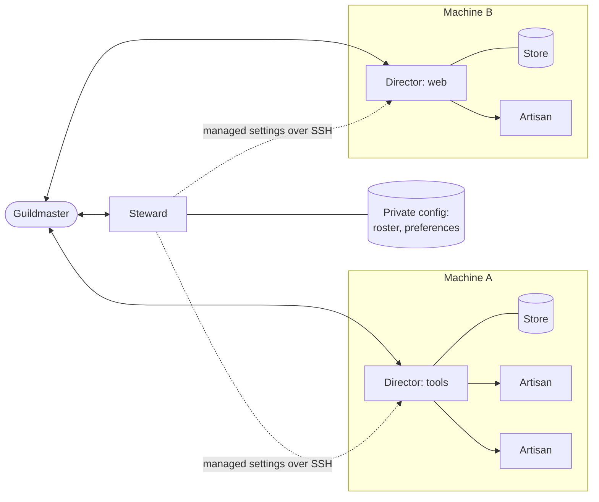
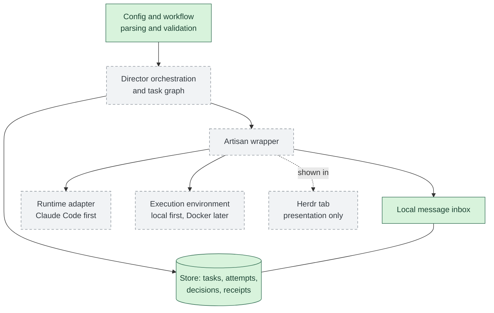
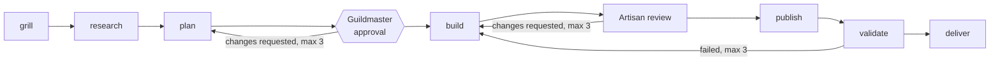
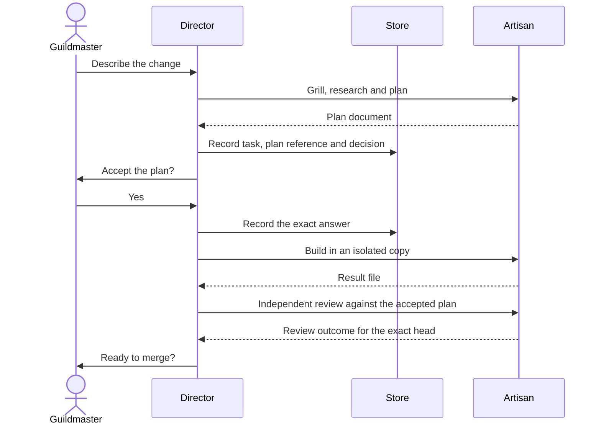

# guildhall

[](https://github.com/ndrwl/guildhall/actions/workflows/ci.yml?query=branch%3Amain)
[](go.mod)
[](LICENSE)

Agent-agnostic local engineering workflows, shared tooling and fleet setup.

Guildhall is at its foundation stage: it builds and runs, but no platform or agent runtime is supported for real work yet.
The specification is in `docs/requirements.md`.

The current foundation provides configuration and workflow parsing and validation, the durable record store and a local message inbox on it, and the Steward's managed-settings rollouts, not a runnable Director or workflow executor.
See [configuration and workflows](docs/configuration.md) for the format, examples and library usage, and [Steward rollouts](docs/steward.md) for rollouts.

## What the badges mean

The CI badge is the live result of the [CI workflow](.github/workflows/ci.yml) on `main`.
CI runs formatting, build, vet, tests and lint on Linux, Windows and macOS for every pull request and every push to `main`.
It makes no model calls and uses no credentials or network in tests.
Passing CI is not live acceptance: no platform or runtime is supported until its acceptance has passed there, and CI on macOS is not live macOS compatibility.
Model-powered review is separate: changes are also reviewed by an automated review and validation pipeline configured in `.no-mistakes.yaml`, which runs outside CI and is not reported by these badges.

## Design

Guildhall coordinates coding agents on the machines one person owns.
A single Go binary owns all state and lifecycle, so the agents it drives are interchangeable and a restart never depends on an agent's transcript.
This section describes the accepted design; [Inside a Director](#inside-a-director) marks which parts are built.

### Roles

- The **Guildmaster** is the human who owns the guild.
  They talk directly to the Steward and to each Director; there is no central dispatcher.
- The **Steward** is the shared maintenance agent.
  It keeps the private central preferences and the roster of enrolled machines, and on request rolls managed settings out to enrolled Director copies over SSH.
- A **Director** coordinates one or more repositories on its one owner machine.
  It only orchestrates: it tracks tasks, launches Artisans and brings decisions to the Guildmaster, but never does the work itself.
- An **Artisan** is a task worker launched by a Director to do one task attempt in an isolated copy of its repository.
- The Go **core** owns durable state: each Director copy has one store holding its tasks, attempts, decisions, document references, pane bindings and messages.



Work moves between Directors only by manual handoff, never by automatic cross-Director scheduling.
A machine may host several Directors, and each Director works only on its own machine.

### Inside a Director

The figure separates what is on `main` today from the boundaries that are designed but not built.



Green boxes are on `main`; grey dashed boxes are designed but not built.

- The intended **Artisan wrapper** runs each attempt: it starts the agent through a runtime adapter, inside an execution environment, and delivers stored messages to it.
- A **runtime adapter** launches an agent's normal interactive session with a prompt file and working directory; an attempt completes only when the Artisan writes a valid result file, not when a process exits or a terminal closes.
  The planned adapters are Claude Code first and a fake test-only adapter for runtime-neutral CI; neither is implemented yet.
- The **execution environment** is the local machine first; a Docker environment is a planned separate boundary and is not built.
- **Herdr**, a terminal multiplexer, shows each Director and Artisan in its own tab.
  A tab is a presentation binding only: closing it, restarting Herdr or rebooting never changes task state or loses work.
- **Messages** carry information only: a message never records a result, answers a decision or approves a merge.

### Workflows

Each task runs a JSON workflow made of built-in, versioned step kinds; a workflow cannot contain commands or code.
Each step names who fulfils it: an Artisan, the Guildmaster, the Director or Guildhall itself.
Loops are bounded, Guildmaster steps are durable pauses that spend no model tokens, and every repository's merge policy applies whatever the workflow says.
The shipped [default workflow](internal/workflow/default.json) is:



A repository can have the Guildmaster review instead of an Artisan without changing any other repository; see [configuration and workflows](docs/configuration.md).
Workflows are parsed and validated as a Go library today; nothing executes them yet.

## Build

Guildhall needs Go 1.27 or later.

```sh
go build -o guildhall ./cmd/guildhall
```

The release workflow publishes binaries for Linux, Windows and macOS, with a `SHA256SUMS` file, only for pushed version tags; manual runs produce downloadable workflow artifacts without publishing a release.
No release has been published yet.

## Commands

Each command is described in its own page; a new command adds its page and one line here.

- `guildhall version` prints the Guildhall version, platform and Go version.
- `guildhall doctor` prints the OS, architecture, Guildhall version and build-time Go version, then, for `git`, `ssh`, `claude` and `herdr`, the first non-blank version-output line and resolved path or why the version could not be read.
  A missing tool is reported, not treated as an error.
- `guildhall store doctor <path>` checks a store file read-only; see [the store](docs/store.md).
- `guildhall steward rollout` previews and applies rollouts of the private managed settings; see [Steward rollouts](docs/steward.md).
- `guildhall messages send|list|read|ack` handles local Director and Artisan messages kept in a store; see [messaging](docs/messaging.md).
- `guildhall workflow approve|approvals` records and lists workflow approvals; see [workflow-edit authority](docs/configuration.md#workflow-edit-authority).
- `guildhall render <request.json>` renders a prompt with embedded release skills first; see [prompt rendering](docs/rendering.md).
- `guildhall artisan run` and `guildhall fake-artisan` launch one Artisan attempt with the test-only fake adapter; see [adapters](docs/adapters.md).
- `guildhall task new|show|list|timeline|files` creates and inspects tasks without launching anything; see [tasks](docs/tasks.md).
- `guildhall decide list|show|answer` lists, shows and answers decisions waiting for the Guildmaster; see [decisions](docs/decisions-cli.md).
- `guildhall help` lists the commands.

## Examples

### Check the build

```console
$ ./guildhall version
guildhall v0.0.0-20261020184157-8090cc664d0a linux/amd64 go1.27.2
$ ./guildhall doctor
os: linux
arch: amd64
guildhall: v0.0.0-20261020184157-8090cc664d0a
go: go1.27.2
...
```

The version and platform depend on your build, and the lines after `go:` report `git`, `ssh`, `claude` and `herdr` on your machine.

### Send and acknowledge a message

No command creates a store yet, so this example uses a copy of the store file the tests use, which holds task `t-1` in repository `app`.
Work on a copy, never on the committed file.

```sh
cp internal/store/testdata/schema-v1.store demo.store
cat > note.json <<'EOF'
{"schema": "guildhall.message/1", "id": "t-1-note-1", "recipient": "director", "repository": "app", "task": "t-1", "type": "note", "text": "Build finished; the plan is ready for review."}
EOF
./guildhall messages send --store demo.store director note.json
./guildhall messages list --store demo.store director
./guildhall messages ack --store demo.store director t-1-note-1
./guildhall store doctor demo.store
```

`send` prints the receipt only after the message is committed, and sending the same envelope again prints the same receipt and stores nothing new:

```json
{"mutation_id":"message:t-1-note-1","operation":"send-message","request_digest":"sha256:8c4f3149fed51b4795c3dedf5bb628671bd249f1c5923c77723be239346f628f","repository":"app","task_id":"t-1","sequence":8,"committed_at":"2026-10-20T19:06:04.839891945Z"}
```

`list` shows the unacknowledged message, and after `ack` the inbox is empty while the message stays readable by id:

```console
$ ./guildhall store doctor demo.store
store: demo.store
schema_version: 1 (supported: 1)
integrity: ok
receipts: 9
workflow approvals: 0
repository app: tasks 1, attempts 1, documents 1, pane bindings 1, decisions 1, messages 1 (0 unread)
```

### Preview a Steward rollout

A rollout needs a private config directory with a roster of enrolled machines, which this repository does not ship, and SSH access to those machines.
Use the [dry-run procedure](docs/steward.md#dry-run) to preview changes and save a local plan:

```sh
./guildhall steward rollout --config steward.toml --machine workstation --plan rollout-plan --dry-run
```

See [Steward rollouts](docs/steward.md) for the roster format, the printed plan, approval and `--apply`.

### A task, end to end (illustrative, not built)

This is the intended flow once Directors run tasks; the orchestration shown below is not implemented yet.



## Documentation

- `docs/requirements.md`: the product requirements.
- `docs/review.md`: the review standard every pull request is held to.
- `docs/decisions.md`: the index of engineering decisions, one file each under `docs/decisions/`.
- `docs/contracts.md`: how contracts, interfaces, tests and packages are organised, with one contract file per package under `docs/contracts/`.
- `docs/store.md`: the store's records, mutation receipts and locking.
- `docs/steward.md`: Steward rollouts.
- `docs/messaging.md`: the local Director and Artisan message inbox.
- `docs/adapters.md`: the Artisan adapter contract, result file and Herdr access.
- `docs/tasks.md`: creating Director tasks and the workflow and configuration they bind.
- `docs/rendering.md`: Artisan prompts, skills, their manifest and Guildmaster questions.
- `CONTRIBUTING.md`: how to contribute.
