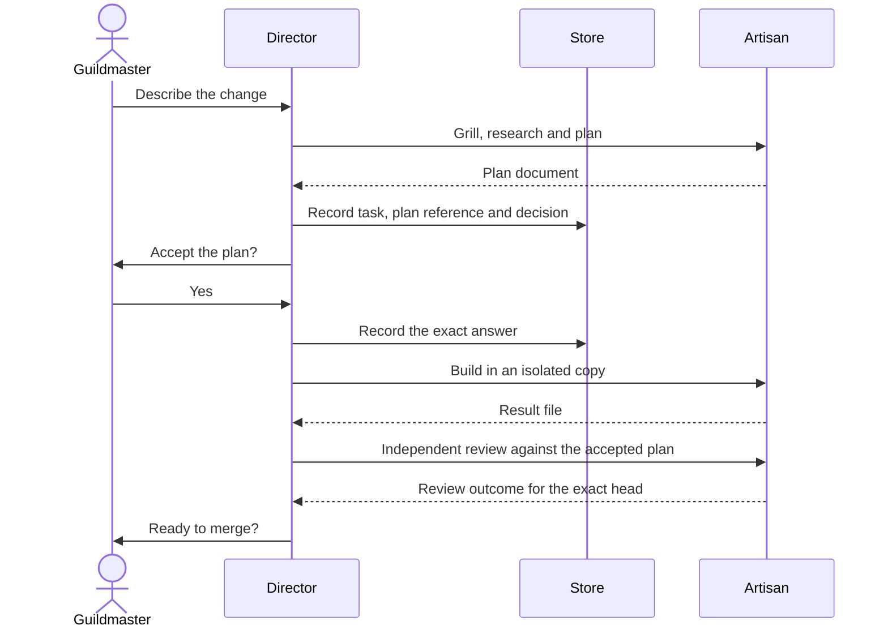
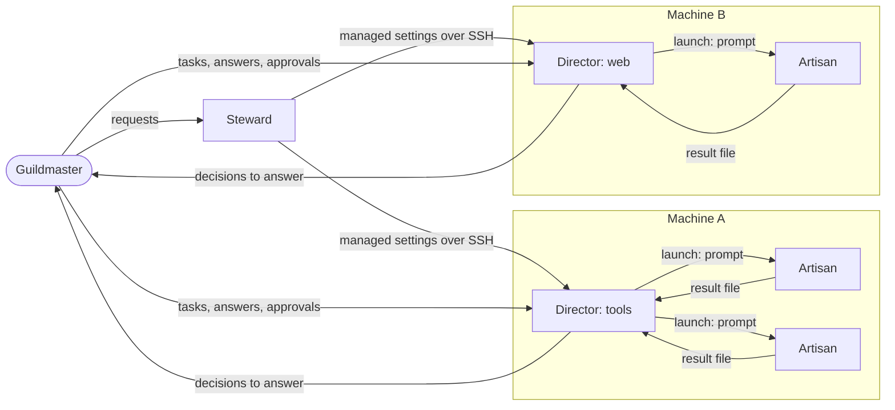
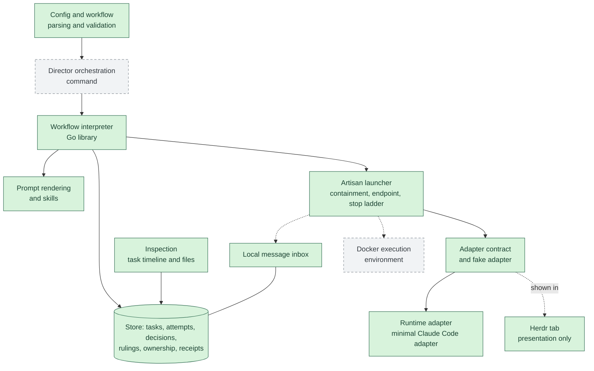

# Architecture

This page holds the internals the [README](../README.md) leaves out: what runs where, how the commands relate to the Director, and what CI does and does not prove.
The product requirements are in [requirements.md](requirements.md).

## Who calls the commands

Everything a Director does for you is a `guildhall` command, and the commands are the only way anything changes the store.
The same commands serve three callers:

- **The Director**, which calls them through its rendered skills (see [prompt rendering](rendering.md)); every request in the [README conversation](../README.md#how-you-will-use-it) maps to a command in the [README list](../README.md#the-commands).
- **You, directly**, when no Director is running, when you want to script something, or when you want to inspect a task yourself; see the [walkthrough](walkthrough.md).
- **An outside monitor**, such as the planned read-only Claude status band (R1.26), which reads status by calling `guildhall` with `--json` and is never state or lifecycle authority.

## The flow of one task

This is the intended flow of one task:

## How it works

This section is the accepted design, for when you want to know what runs where; [Inside a Director](#inside-a-director) marks which parts are built.
A single Go binary owns all state and lifecycle, so the agents it drives are interchangeable and a restart never depends on an agent's transcript.

### Roles

Each role owns a fixed set of things; the next figure shows how they talk.

| Role | What it is | What it owns |
| --- | --- | --- |
| **Guildmaster** | The human who owns the guild | Answers to decisions and approvals |
| **Steward** | The shared maintenance agent | The private central preferences and the roster of enrolled machines |
| **Director** | The coordinator of one or more repositories on its one owner machine | Its tasks: it tracks them, launches Artisans and brings decisions to the Guildmaster, but never does the work itself |
| **Artisan** | A task worker launched by a Director | One task attempt in an isolated copy of its repository |
| Go **core** | The single Guildhall binary | All durable state and lifecycle: each Director copy has one store holding its tasks, attempts, decisions, document references, pane bindings and messages, so a restart never depends on an agent's transcript |

### Who talks to whom

The Guildmaster talks directly to the Steward and to each Director; there is no central dispatcher.
Each arrow shows one direction and what flows along it.

Messages between a Director and its Artisans inform only; they never carry a result, a decision or an approval.
A machine may host several Directors, and each Director works only on its own machine.
Work moves between Directors only by manual handoff, never by automatic cross-Director scheduling.

### Inside a Director

The figure separates what is on `main` today from the boundaries that are designed but not built.

Green boxes are on `main`; grey dashed boxes are designed but not built, and dotted arrows are connections not yet wired.

- The **Artisan launcher** owns each attempt's worker in a containment unit on the local machine; see [Artisan commands](artisan.md#commands) for the implemented fake-adapter integration.
  `guildhall task start` launches a real agent through the minimal Claude adapter; delivering stored messages to it is not wired yet.
- A **runtime adapter** launches an agent's session with a prompt file and working directory; an attempt completes only when the Artisan writes a valid result file, not when a process exits or a terminal closes.
  The only built runtime adapter, the [Claude adapter](adapters.md#claude-adapter), runs a print-mode session under a wrapper; the designed interactive session, including the Director's, is not built.
  See [adapters](adapters.md) for the fake adapter and the session mode each adapter runs.
- The **execution environment** is the local machine first; a Docker environment is a planned separate boundary and is not built.
- **Herdr**, a terminal multiplexer, shows each Director and Artisan in its own tab.
  A tab is a presentation binding only: closing it, restarting Herdr or rebooting never changes task state or loses work.
- **Messages** carry information only: a message never records a result, answers a decision or approves a merge.

### Workflows

Each task runs a JSON workflow made of built-in, versioned step kinds; a workflow cannot contain commands or code.
Each step names who fulfils it: an Artisan, the Guildmaster, the Director or Guildhall itself.
Loops are bounded, Guildmaster steps are durable pauses that spend no model tokens, and every repository's merge policy applies whatever the workflow says.
The [workflow interpreter](interpreter.md) executes a supported subset; the default workflow is shown under [the walkthrough](walkthrough.md#2-give-it-work).

## What the badges mean

The CI badge is the live result of the [CI workflow](../.github/workflows/ci.yml) on `main`.
CI runs formatting, build, vet, tests and lint on Linux, Windows and macOS for every pull request and every push to `main`.
It makes no model calls and uses no credentials or network in tests.
Passing CI is not live acceptance: no platform or runtime is supported until its acceptance has passed there, and CI on macOS is not live macOS compatibility.
Model-powered review is separate: changes are also reviewed by an automated review and validation pipeline configured in `.no-mistakes.yaml`, which runs outside CI and is not reported by these badges.
