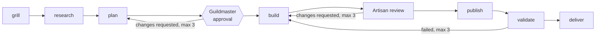

# Walkthrough: driving a task by hand

Until the conversational Director is built, you run the steps it will run, yourself, with the `guildhall` commands.
This page is the full manual walkthrough the [README](../README.md#try-it-today) summarises.

A Director's copy is a directory holding its `config.toml`, its store `director.store` and its `state/` directory; every command below selects it with `--copy demo`, see [copies](running.md#copies).
Create the copy's store with `store init`, which refuses anything already at that path:

```sh
mkdir -p demo/state
./guildhall store init demo/director.store
```

## 1. Set up a Director

A Director's copy holds a `config.toml` naming its repositories, their merge policy and workflow, and its Artisan profiles; see [configuration and workflows](configuration.md).
A Director runs standalone on that config, or managed by a Steward that adds shared settings; see [standalone and managed Directors](director-modes.md) (designed, not built).
Every role will start, stop, report and resume with one grammar, for example `guildhall director start claude`; see [the role grammar](decisions/0053-cli-role-grammar.md).
`guildhall director start claude --copy demo` runs a Director session in your terminal, and `--tab` runs it in its own Herdr tab; see [the Director](director.md#start).
Start a role through Guildhall rather than running the agent directly, so it gets its rendered skills, settings, preflight and recorded identity.

## 2. Give it work

The `task new` and `task start` lines need the copy's Director config, `demo/config.toml`, to declare a `[[repository]]` with `id = "app"` whose `path` is a git checkout; the examples in [configuration and workflows](configuration.md) name other repositories, so change one to `app` before using it.
`task start` uses the role prompt and stage guides shipped in the binary unless a `baseline/` directory beside the config, `demo/baseline/`, overrides them file by file; see [what an advance runs over](running.md#what-an-advance-runs-over).

```sh
./guildhall task new --copy demo --repo app --title "Add a health check" t-1
./guildhall task start --copy demo --repo app t-1
```

A task is one unit of work in one repository; creating it records it and binds the exact workflow and configuration it was accepted under.
`task start` launches the task's next ready stage as an owned Artisan attempt.
The default workflow's first stage, `grill`, is a [Director stage](interpreter.md#director-stages): `task start` hands it to the Director, which interviews you and ends it with `step finish`, and only then does the first Artisan stage launch.
Because the task runs from a copy, each attempt's launcher takes its own result with `step done`, or runs `task start` after a failure so you get an `attempt-failed` message, so you do not type `step done`; see [the watcher](running.md#the-watcher) and [tasks](tasks.md).

Each task follows a workflow.
The shipped [default workflow](../internal/workflow/default.json) is:



A repository can have you review instead of an Artisan without changing any other repository; see [configuration and workflows](configuration.md).

## 3. Watch it

```sh
./guildhall task list --copy demo --json
./guildhall task timeline --copy demo --repo app t-1 --json
```

`task show`, `timeline` and `files` read a task's attempts, decisions and documents without changing anything; `guildhall artisan status` classifies one Artisan attempt; see [Artisan commands](artisan.md#commands).
In the planned setup, Herdr, a terminal multiplexer, shows each Director and Artisan in its own tab; a tab is presentation only, so closing it never changes a task.
Directors and Artisans also exchange informational [messages](messaging.md), which never carry a result, a decision or an approval.

## 4. Answer its decisions

Decisions waiting for you are listed per machine; there is no push service.

```sh
./guildhall decide list --copy demo
./guildhall decide show --copy demo --repo app --task t-1 --decision <id>
printf 'approve\n\nKeep the migration behind a flag.\n' | ./guildhall decide answer --copy demo --repo app --task t-1 --decision <id> --answer-file -
```

Your exact words are recorded; for a decision offering `approve` and `reject`, a leading `approve` is taken as the choice and the rest as a note.
Answering never advances a task by itself: continue it with `task start --decision <id>`.
See [decisions](decisions-cli.md).

## 5. Approve or stop work

Approving a plan or a merge is answering its decision, as above.
To stop one running Artisan attempt, use `guildhall artisan stop`; see [Artisan commands](artisan.md#commands).

## More examples

### Send and acknowledge a message

With the copy from above; the output shown is for a copy where only `task new` has run, so `task start` and answered decisions add their own receipts and records:

```sh
cat > note.json <<'EOF'
{"schema": "guildhall.message/1", "id": "t-1-note-1", "recipient": "director", "repository": "app", "task": "t-1", "type": "note", "text": "Build finished; the plan is ready for review."}
EOF
./guildhall messages send --copy demo director note.json
./guildhall messages list --copy demo director
./guildhall messages ack --copy demo director t-1-note-1
./guildhall store doctor --copy demo
```

`send` prints the receipt only after the message is committed, and sending the same envelope again prints the same receipt and stores nothing new:

```json
{"mutation_id":"message:t-1-note-1","operation":"send-message","request_digest":"sha256:8c4f3149fed51b4795c3dedf5bb628671bd249f1c5923c77723be239346f628f","repository":"app","task_id":"t-1","record":"message/t-1-note-1","sequence":2,"committed_at":"2026-10-22T07:56:28.47136214Z"}
```

`list` shows the unacknowledged message, and after `ack` the inbox is empty while the message stays readable by id.
With no Director session recorded, the send also recorded its [wake](messaging.md#waking-the-director) as `queued`, which is one of the receipts:

```console
$ ./guildhall store doctor --copy demo
store: demo/director.store
schema_version: 1 (supported: 1)
integrity: ok
receipts: 4
workflow approvals: 0
repository app: tasks 1, attempts 0, documents 0, pane bindings 0, decisions 0, rulings 0, owners 0 (0 starting without containment), messages 1 (0 unread)
```

### Preview a Steward rollout

A rollout needs a private config directory with a roster of enrolled machines, which this repository does not ship, and SSH access to those machines.
Use the [dry-run procedure](steward.md#dry-run) to preview changes and save a local plan:

```sh
./guildhall steward rollout --config steward.toml --machine workstation --plan rollout-plan --dry-run
```

See [Steward rollouts](steward.md) for the roster format, the printed plan, approval and `--apply`.
